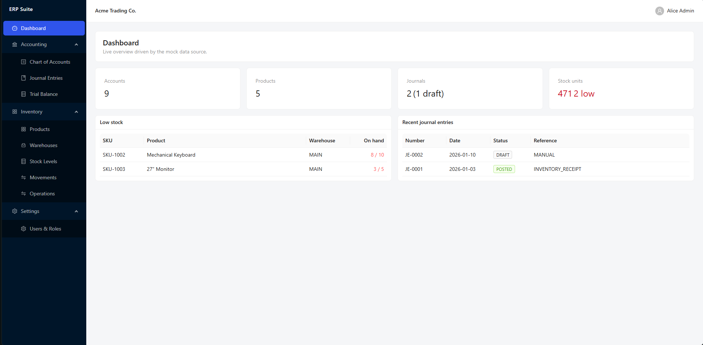
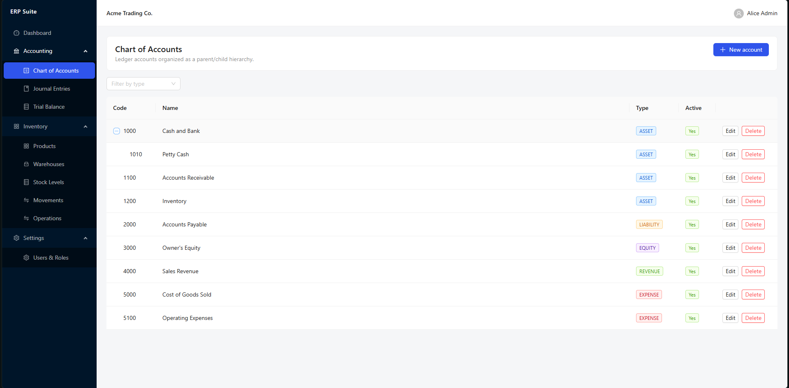
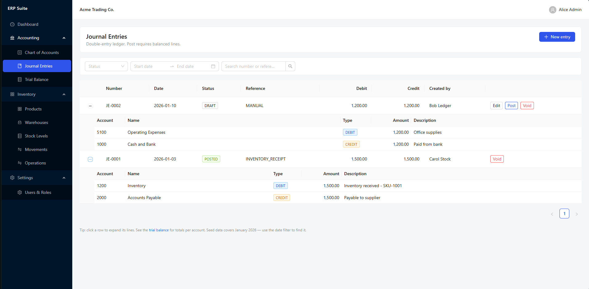
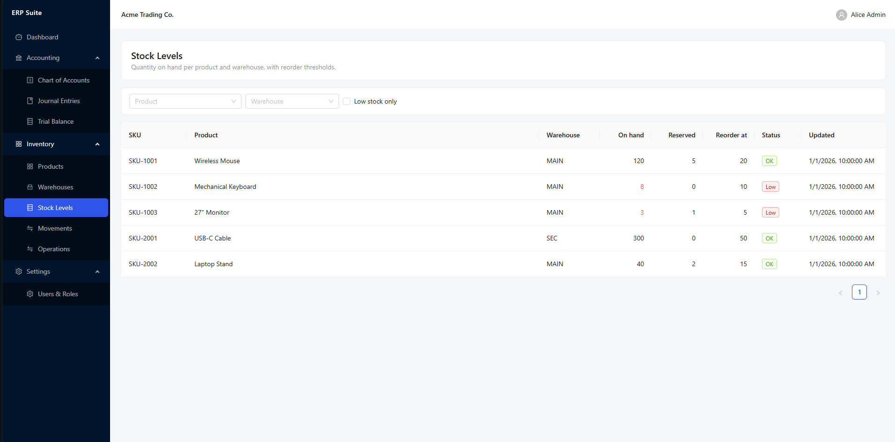
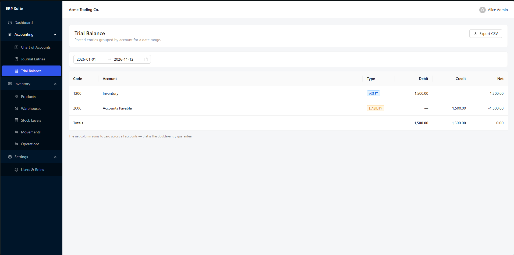

# ERP Suite


A modular Enterprise Resource Planning (ERP) suite for running core business
operations from a single web application. It brings financial accounting and
inventory management together on one consistent, auditable ledger, protected by
role-based access control and per-company data isolation.

## Setup

### Prerequisites

- Node.js 20+ (npm 10+)
- Docker with WSL2 backend (on Windows hosts, npm commands run from a WSL shell)

### Install & run

```bash
cp .env.example .env            # repo root — database, redis, API config
npm install                     # from WSL on Windows hosts (see note below)
npm run infra:up                # Postgres (:15432) + Redis (:16379) containers
npm run db:generate -w apps/api # Prisma client
npm run db:migrate  -w apps/api # schema migrations
npm run db:seed     -w apps/api # demo company, users, chart of accounts, stock
npm run dev                     # API on :4000 + web on :5173 (concurrently)
```

> **Windows note:** install and run commands must be executed from WSL
> (`wsl -e bash -lc "cd /mnt/d/<repo> && npm run dev"`) — the Linux
> esbuild/rollup binaries are selected at install time and a Windows install
> breaks them. The browser runs normally on Windows at `http://localhost:5173`.

Seeded logins (password `Passw0rd!` for all):

| User | Role |
| --- | --- |
| `admin@acme.test` | ADMIN — full access |
| `accountant@acme.test` | ACCOUNTANT — accounting, no users/inventory writes |
| `store@acme.test` | STOREKEEPER — inventory only |

Optional extras:

```bash
npm run db:seed:demo -w apps/api  # a month of journal activity (for screenshots)
npm run test                      # unit/integration tests (all workspaces)
npm run e2e                       # golden-path smoke on a FRESH db (resets it)
```

### Production

```bash
npm run build   # static web build → apps/web/dist
npm start       # API on :4000
```

## Screenshots

A quick tour of the app (seeded demo data).

### Dashboard

Live overview of the company: account, product and journal counts, total stock
units, low-stock alerts, and the most recent journal entries.



### Chart of Accounts

The ledger's accounts (assets, liabilities, equity, revenue, expenses) organized
as a parent/child hierarchy. Accounts can be created, edited, and deactivated.



### Journal Entries

The double-entry ledger. Entries live in a draft → posted → voided lifecycle and
can only be posted when Σ debits = Σ credits. Expand a row to inspect its lines.



### Stock Levels

Quantity on hand and reserved per product and warehouse, with reorder
thresholds and low-stock highlighting. Receives and issues adjust stock and
post their journal entries automatically.



### Trial Balance

Posted entries grouped by account for any date range. The net column sums to
zero across all accounts — that is the double-entry guarantee. Exportable to
CSV.



## Functionality

### Financial Accounting & General Ledger
- Strict double-entry bookkeeping — every entry must balance (Σ debits = Σ credits) before it can be posted.
- Chart of accounts with a parent/child hierarchy.
- Journal entries with a draft → posted → voided lifecycle.
- Trial balance reporting over any date range.

### Inventory & Warehouse Management
- Product catalog with SKUs, units of measure, and reorder thresholds.
- Multiple warehouses with per-warehouse stock levels.
- An immutable movement ledger (goods receipts, sales issues, transfers, adjustments) for full auditability.
- Low-stock highlighting against reorder thresholds.
- Goods receipts and sales issues post a balanced journal entry automatically.

### Access Control
- Role-based access control with permissions at the module and action level.
- Company (tenant) scoping, so each company only sees its own data.

### Web application screens
- **Dashboard** — company overview: account, product and journal counts, low-stock items, and recent journal entries.
- **Accounting** — Chart of Accounts, Journal Entries, Trial Balance.
- **Inventory** — Products, Warehouses, Stock Levels, Movements, and inventory operations (receipt, issue, transfer, adjustment).
- **Settings** — users and roles.

## API Endpoints

All endpoints are served under `/api/v1` and use JSON. Errors share a single
envelope: `{ "error": { "code": "...", "message": "...", "details": ... } }`.

### Authentication
| Method | Endpoint | Description |
| --- | --- | --- |
| POST | `/auth/login` | Sign in with email and password. |
| POST | `/auth/refresh` | Exchange a refresh token for a new access token. |
| POST | `/auth/logout` | Revoke the current refresh token. |
| GET | `/auth/me` | Current user with roles and permissions. |

### Chart of Accounts
| Method | Endpoint | Description |
| --- | --- | --- |
| GET | `/accounts` | List accounts. |
| POST | `/accounts` | Create an account. |
| GET | `/accounts/:id` | Get a single account. |
| PATCH | `/accounts/:id` | Update an account. |
| DELETE | `/accounts/:id` | Delete an account. |

### Journal Entries
| Method | Endpoint | Description |
| --- | --- | --- |
| GET | `/journals` | List entries (filter by date, status, reference type). |
| POST | `/journals` | Create a draft entry with its lines. |
| GET | `/journals/:id` | Get an entry with its lines. |
| PATCH | `/journals/:id` | Edit a draft entry. |
| POST | `/journals/:id/post` | Post a draft entry (must balance). |
| POST | `/journals/:id/void` | Void an entry. |
| GET | `/reports/trial-balance` | Trial balance for a date range. |

### Products
| Method | Endpoint | Description |
| --- | --- | --- |
| GET | `/products` | List products. |
| POST | `/products` | Create a product. |
| GET | `/products/:id` | Get a single product. |
| PATCH | `/products/:id` | Update a product. |
| DELETE | `/products/:id` | Delete a product. |

### Warehouses
| Method | Endpoint | Description |
| --- | --- | --- |
| GET | `/warehouses` | List warehouses. |
| POST | `/warehouses` | Create a warehouse. |
| GET | `/warehouses/:id` | Get a single warehouse. |
| PATCH | `/warehouses/:id` | Update a warehouse. |
| DELETE | `/warehouses/:id` | Delete a warehouse. |

### Inventory
| Method | Endpoint | Description |
| --- | --- | --- |
| GET | `/inventory/stock` | Stock levels (filter by product, warehouse, low-stock). |
| GET | `/inventory/movements` | Movement ledger (filter by product, warehouse, type, date). |
| POST | `/inventory/receipts` | Receive goods into a warehouse. |
| POST | `/inventory/issues` | Issue goods out of a warehouse. |
| POST | `/inventory/transfers` | Transfer stock between warehouses. |
| POST | `/inventory/adjustments` | Adjust stock with a reason. |

### Reports
| Method | Endpoint | Description |
| --- | --- | --- |
| GET | `/reports/dashboard` | Counts, low-stock items, and recent journal entries. |
| GET | `/health` | Service liveness and dependency health. |

### Users & Roles
| Method | Endpoint | Description |
| --- | --- | --- |
| GET | `/users` | List users with their roles and permissions. |
| GET | `/users/roles` | List the company's roles with their permissions. |
| POST | `/users/:id/role` | Assign a role to a user (replaces the current one). |
