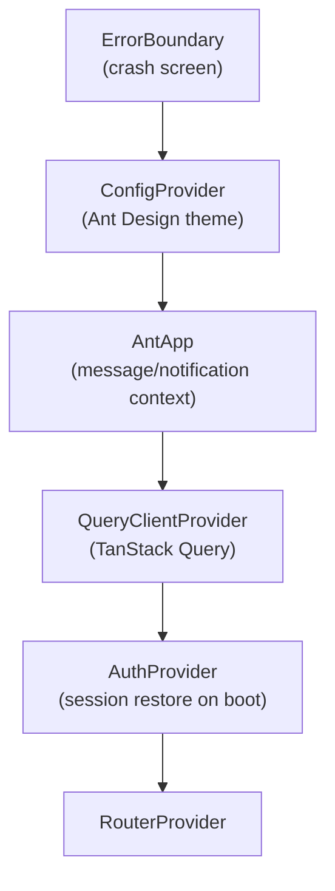
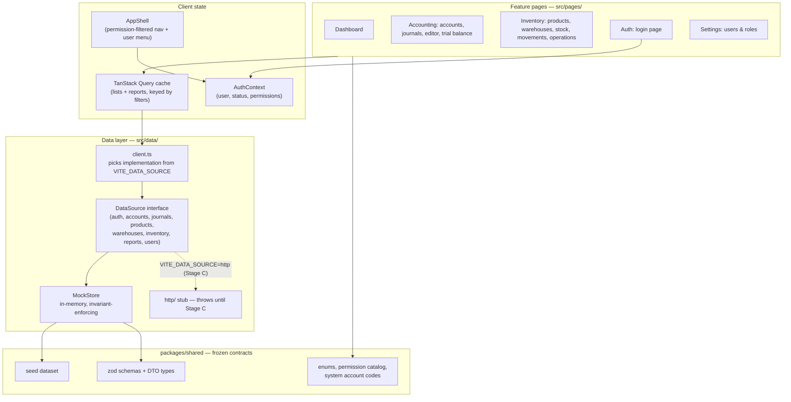
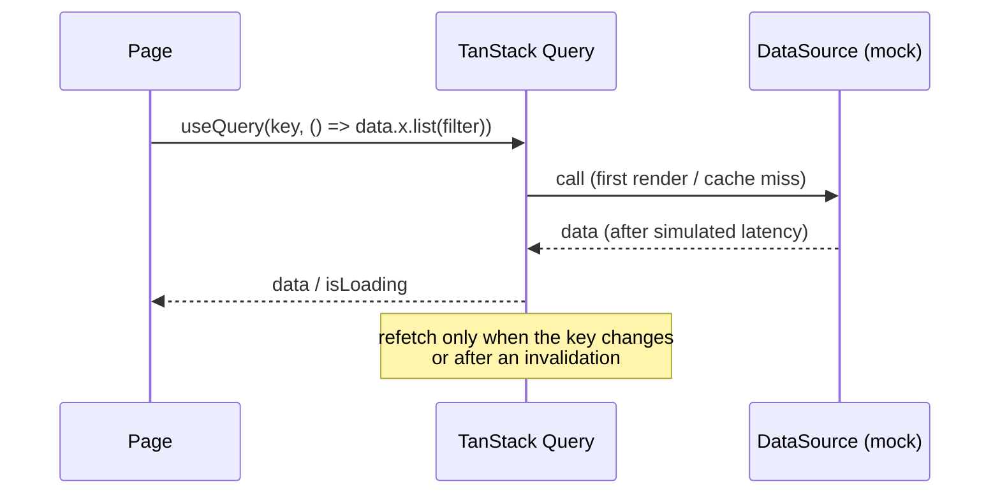
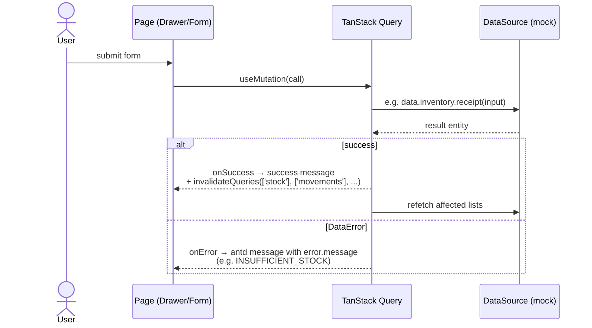
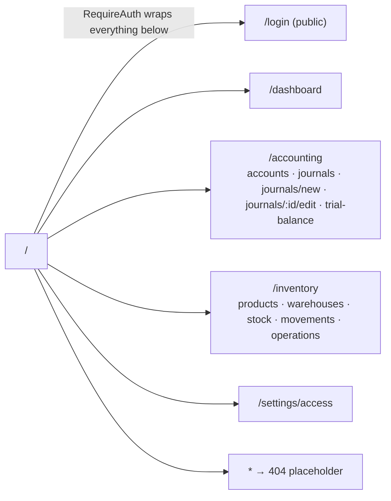

# Client Architecture (Stage A)

> How `apps/web` is wired as built in Phase A. The key property: every page
> talks to a **single `DataSource` interface**, so swapping the in-memory mock
> for the real HTTP API (Stage C) is a one-line env change.

## 1. Bootstrap chain (`main.tsx`)

## 2. Layers

## 3. Read path (queries)

- Query keys encode the resource **and its filters** (e.g. `['stock', filter]`), so changing a filter is a different cache entry, not a mutation.
- `DataError` with `status < 500` is never retried; transient failures retry twice.

## 4. Write path (mutations + invalidation)

## 5. Routing map

## 6. Environment flags

| Flag | Default | Meaning |
| --- | --- | --- |
| `VITE_DATA_SOURCE` | `mock` | `mock` → in-memory store; `http` → real API (Stage C). |
| `VITE_MOCK_LATENCY` | `250` | Simulated latency (ms) so loading states are real. |
| `VITE_API_URL` | `/api/v1` | API base URL used by the HTTP source (Stage C). |

## 7. Module map

| Path | Responsibility |
| --- | --- |
| `src/main.tsx` | Bootstrap chain (§1). |
| `src/router.tsx` | Route table; public `/login`, guarded app routes. |
| `src/auth/` | `AuthProvider` (session, login/logout, token storage), `RequireAuth`, `usePermission`. |
| `src/layouts/AppShell.tsx` | Sidebar (nav filtered by permissions), header (company, data-source tag, user menu). |
| `src/data/index.ts` | The `DataSource` contract — the only data surface pages may use. |
| `src/data/client.ts` | Chooses the implementation from `VITE_DATA_SOURCE`. |
| `src/data/mock/` | `MockStore`: seeded in-memory state + all domain invariants. |
| `src/data/http/` | Stub; implemented in Stage C with axios + refresh interceptor. |
| `src/pages/` | One folder per feature (accounts, journals, trialBalance, products, warehouses, stock, movements, operations, settings). |
| `src/lib/` | Query client, money/date formatters, journal totals math, CSV download. |
| `src/components/` | `PageHeader`, `ErrorBoundary`. |
