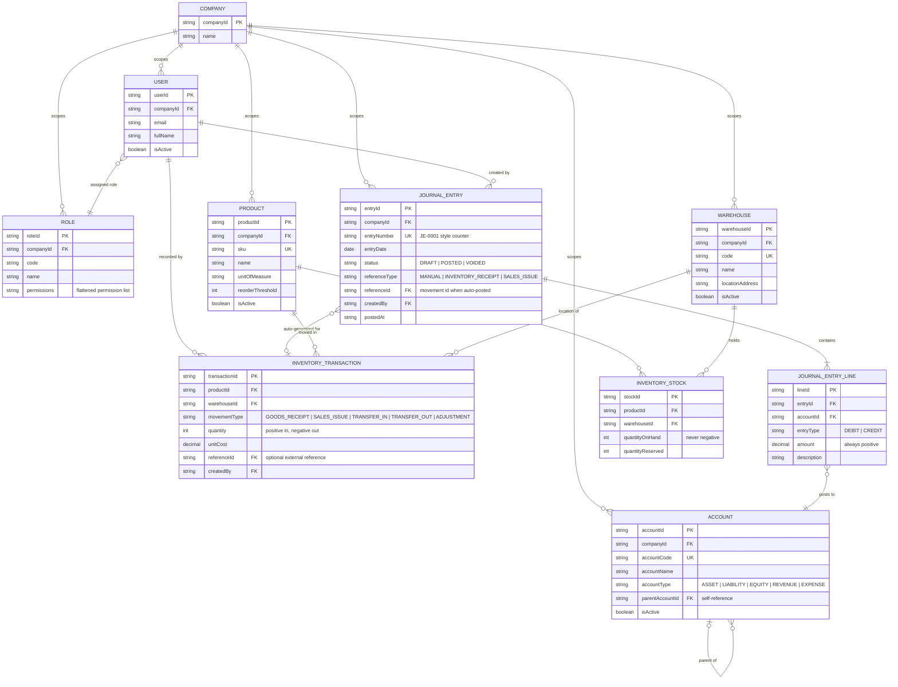

# Entity-Relationship Diagram (Stage A)

> Mirrors exactly what is implemented in Phase A of `apps/web`: the in-memory
> mock store (`apps/web/src/data/mock/store.ts`) and the frozen DTO contracts
> (`packages/shared/src/schemas/*`). Stage B maps this model 1:1 onto Postgres
> tables; the DB-level source of truth remains `dev/docs/erd.md`.

## Diagram

## Entities

| Entity | Lives in | What it is | Key rules enforced by the mock store |
| --- | --- | --- | --- |
| `COMPANY` | `packages/shared/src/seed` | The tenant ("Acme Trading Co."). Single company in v1; every business row carries its id. | All data is scoped to it. |
| `ROLE` | seed roles | Named permission bundle: `ADMIN`, `ACCOUNTANT`, `STOREKEEPER`, `VIEWER`. | Permissions are a flattened list per role (Stage B normalizes into `permissions` + `role_permissions` tables). |
| `USER` | seed users | A sign-in identity with email, name and one assigned role. | Login requires exact email + password (`INVALID_CREDENTIALS` otherwise). |
| `ACCOUNT` | `accounts` state | Chart-of-accounts node; self-referencing tree via `parentAccountId`. | Unique code (`DUPLICATE_CODE`); cannot be its own parent; cannot be deleted while it has children or journal lines (`ACCOUNT_IN_USE`). |
| `PRODUCT` | `products` state | Item catalog entry (SKU, unit of measure, reorder threshold). | Unique SKU (`DUPLICATE_SKU`); cannot be deleted with stock on hand or movement history (`PRODUCT_IN_USE`). |
| `WAREHOUSE` | `warehouses` state | Stock-keeping location. | Unique code; cannot be deleted while holding stock or having movement history (`WAREHOUSE_IN_USE`). |
| `INVENTORY_STOCK` | `stock` rows | Per-(product, warehouse) quantity bucket. Created lazily on first movement. | `quantityOnHand` can never go negative (DB CHECK mirrored in code). |
| `INVENTORY_TRANSACTION` | `movements` list | Append-only movement ledger. Signed quantity: positive = in, negative = out. | Rows are never updated or deleted — new facts are new rows. |
| `JOURNAL_ENTRY` | `journals` list | Double-entry document with a draft → posted → voided lifecycle. | ≥ 2 lines with positive amounts; `POSTED` requires Σ debits = Σ credits; posted entries are immutable. |
| `JOURNAL_ENTRY_LINE` | entry lines | One debit or credit against an account. | Amount always positive; side is `DEBIT` or `CREDIT`. |

## Relationships

| From | To | Cardinality | Meaning |
| --- | --- | --- | --- |
| `COMPANY` | `USER` / `ROLE` / `ACCOUNT` / `PRODUCT` / `WAREHOUSE` / `JOURNAL_ENTRY` | 1 : N | Tenant scoping — every record belongs to one company. |
| `USER` | `ROLE` | N : 1 | Each user has exactly one role in v1 (assignable in Settings). |
| `USER` | `JOURNAL_ENTRY`, `INVENTORY_TRANSACTION` | 1 : N | Audit: who created/recorded the record (`createdBy` + display name). |
| `ACCOUNT` | `ACCOUNT` | 0..1 parent : N children | Chart-of-accounts hierarchy. |
| `JOURNAL_ENTRY` | `JOURNAL_ENTRY_LINE` | 1 : 2..N | A journal always has at least two lines. |
| `JOURNAL_ENTRY_LINE` | `ACCOUNT` | N : 1 | Every line posts to exactly one ledger account. |
| `JOURNAL_ENTRY` | `INVENTORY_TRANSACTION` | 0..1 : 1 | A goods receipt or sales issue auto-generates one POSTED entry referencing the movement (`referenceType` + `referenceId`). |
| `PRODUCT` + `WAREHOUSE` | `INVENTORY_STOCK` | 1 : N each | Stock is the join between a product and a warehouse — one row per pair. |
| `PRODUCT` / `WAREHOUSE` | `INVENTORY_TRANSACTION` | 1 : N | Each movement touches exactly one product in exactly one warehouse. |

## Integration account mapping

Inventory operations post journal entries against fixed system accounts
(`SYSTEM_ACCOUNT_CODES` in `packages/shared`):

| Operation | Debit | Credit |
| --- | --- | --- |
| Goods receipt | `1200` Inventory | `2000` Accounts Payable |
| Sales issue | `5000` Cost of Goods Sold | `1200` Inventory |
| Transfer / Adjustment | — (no journal entry in v1) | — |
