# Operations & Workflows (Stage A)

> Documents the workflows a user can actually drive in `apps/web` as built in
> Phase A (mock data source). Every rule shown here is enforced by the mock
> store, so it matches what Stage B's database will enforce.

## 1. Signing in and session handling

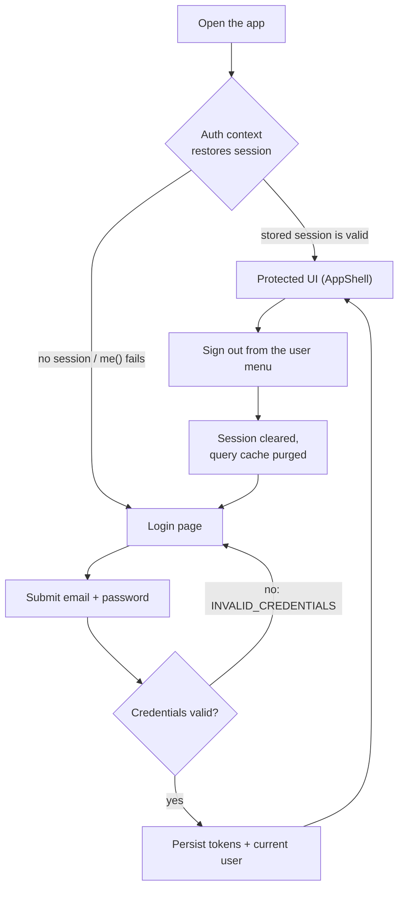

- Tokens (`mock-access.*`) are stored in `localStorage` (`src/auth/tokenStorage.ts`) — the same place the Stage C HTTP client will read them from.
- The mock store persists the current user id so a page reload keeps the session.

## 2. Route protection

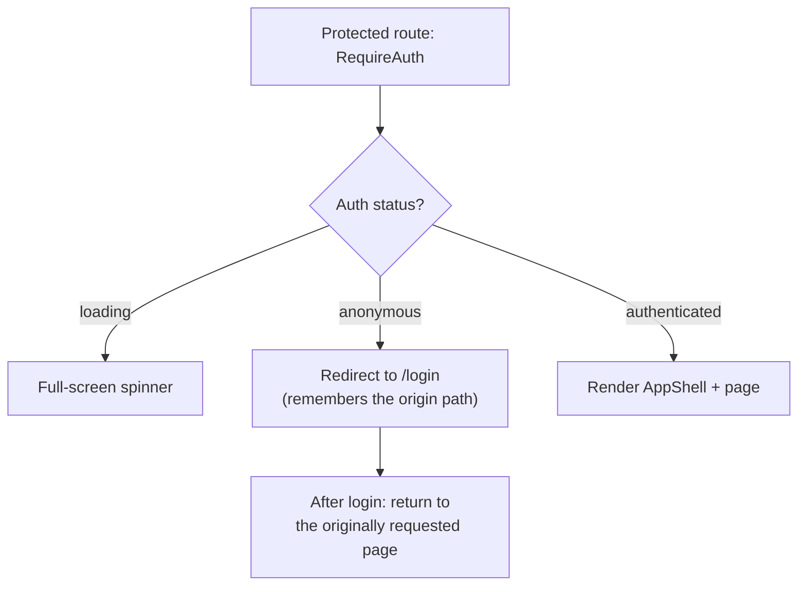

## 3. Role-based access control (RBAC)

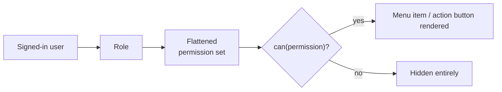

What each seeded role can see (permissions from `packages/shared`):

| Role | Dashboard | Accounting | Inventory | Operations (write) | Settings |
| --- | --- | --- | --- | --- | --- |
| `ADMIN` | ✔ | full + write | full + write | ✔ | users + role assignment |
| `ACCOUNTANT` | ✔ | full + write | read only | ✖ (read-only notice) | ✖ hidden |
| `STOREKEEPER` | ✔ | ✖ hidden | full + write | ✔ | ✖ hidden |
| `VIEWER` | ✔ | read only | read only | ✖ | ✖ hidden |

## 4. Journal entry lifecycle

```mermaid
stateDiagram-v2
    [*] --> DRAFT : create (save draft)
    DRAFT --> DRAFT : edit date / reference / lines
    DRAFT --> POSTED : post — requires Σ debits = Σ credits
    DRAFT --> VOIDED : void draft
    POSTED --> POSTED : immutable; void posts a mirror reversal
    VOIDED --> [*]
```

- Only drafts can be edited (`ENTRY_NOT_EDITABLE`) and only drafts can be posted (`ENTRY_NOT_POSTABLE`).
- Voiding a `DRAFT` flips it to `VOIDED`. Voiding a `POSTED` entry leaves it `POSTED` and posts a linked `REVERSAL` entry (`referenceType: 'REVERSAL'`, `referenceId` → original, mirrored debit/credit lines, dated today), so prior-period reports stay reproducible; the pair nets to zero.
- `reversedByEntryId` on the original points at its reversal; the list shows a `REVERSED` tag.
- `VOIDED` is terminal and a second void — or voiding an already-reversed entry — is rejected (`ENTRY_ALREADY_VOID`).

## 5. Creating and posting a journal entry

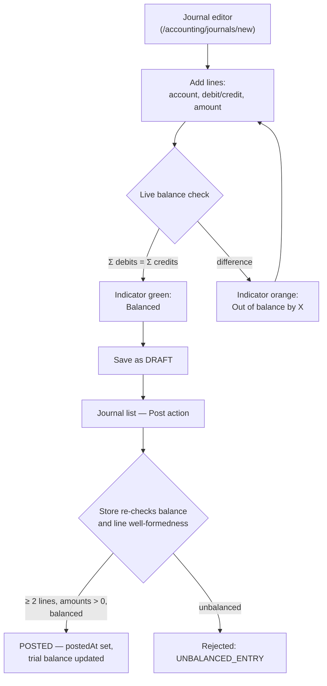

- Drafts are allowed to be unbalanced; the guard fires only at `post()`.
- The same editor page handles create (`new`) and edit (`:entryId/edit`, drafts only).

## 6. Chart of accounts maintenance

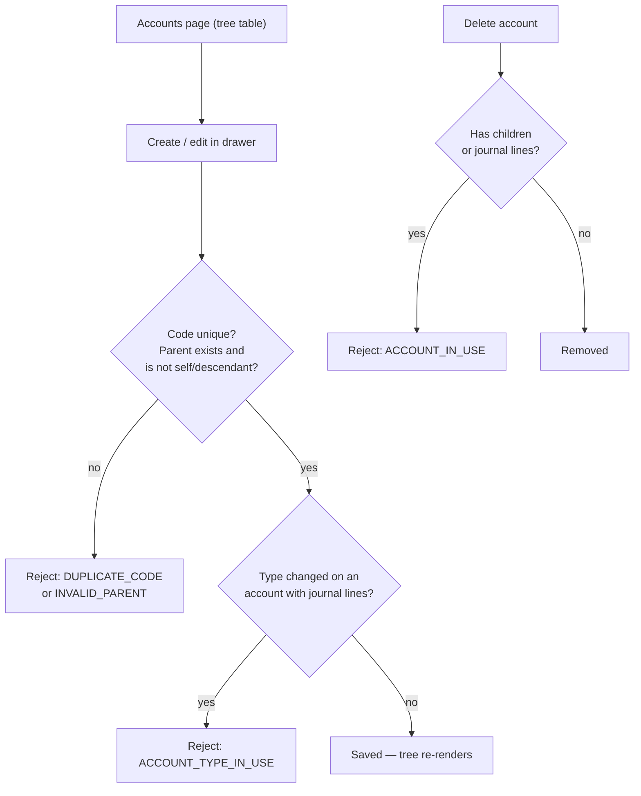

- A parent assignment that would form a cycle (including self-parenting) is rejected (`INVALID_PARENT`).
- Once an account has journal lines its type is fixed (`ACCOUNT_TYPE_IN_USE`); retire it by deactivating it instead of deleting.

## 7. Goods receipt (Inventory → General Ledger integration)

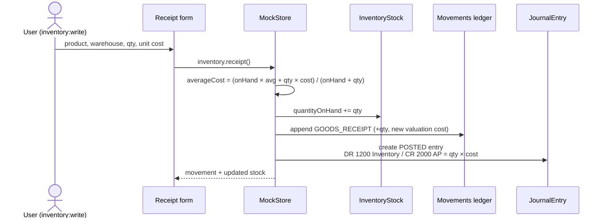

One operation produces **one stock increase, one append-only movement, and one balanced POSTED journal entry**. The receipt cost also blends into the product's company-wide weighted-average cost.

## 8. Sales issue

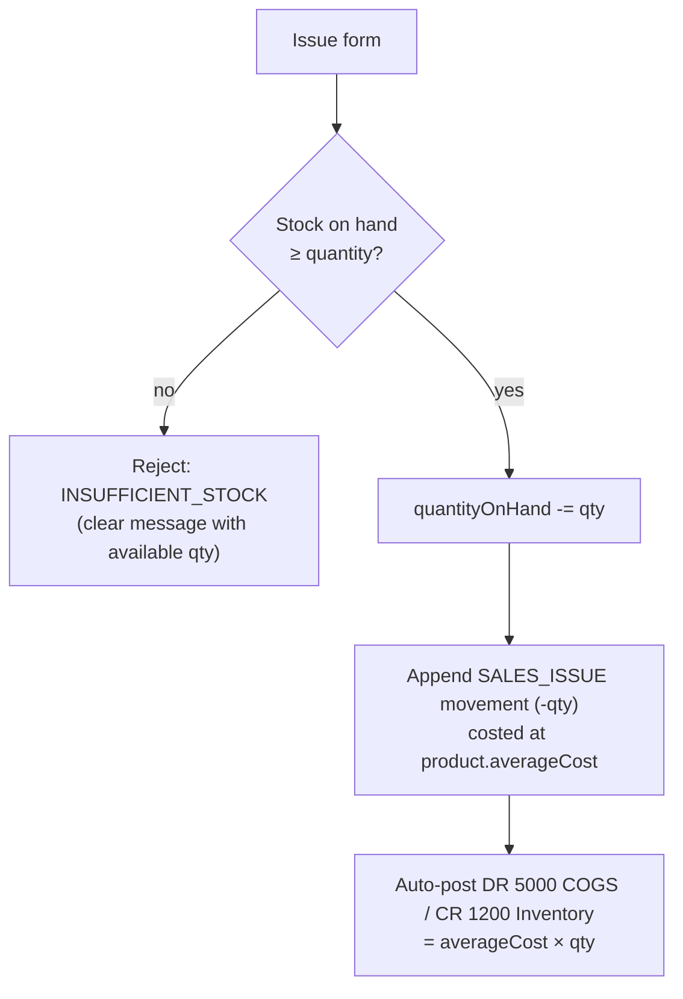

Issue cost is never client-supplied; the form only collects product, warehouse and quantity.

## 9. Warehouse transfer

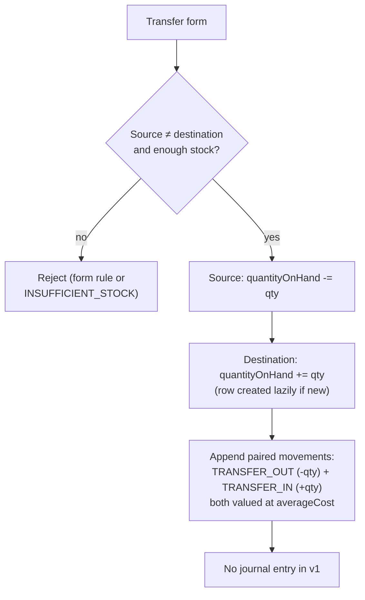

## 10. Stock adjustment

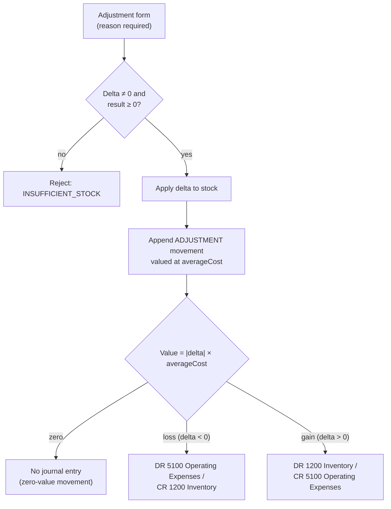

Every stock-affecting operation either posts a balanced entry or is explicitly
non-posting:

| Operation | GL behaviour |
| --- | --- |
| Goods receipt | DR `1200` / CR `2000`; zero-cost receipts post nothing. |
| Sales issue | DR `5000` / CR `1200` at valuation cost; zero-value issues post nothing. |
| Warehouse transfer | No GL entry — both warehouses belong to the same inventory account. |
| Stock adjustment | Gain/loss against `5100`; zero-value adjustments post nothing. |

Because every value-changing movement posts, the `1200` Inventory balance
reconciles to the valuation report total. The integration test asserts this on a
fresh company/product; seeded data is posted the same way.

## 10a. Inventory reports (valuation, movement summary, aging)

**Valuation** values stock per **(product, warehouse)** at the product's company-wide running `averageCost` and reconciles it to the posted inventory account (`1200`):

```
value(row) = stock.quantityOnHand × product.averageCost
report.totalValue = Σ value(rows with quantityOnHand ≠ 0)
report.difference = totalValue - inventoryAccountBalance
```

`GET /reports/inventory-valuation` returns `{ rows, totalValue, inventoryAccountBalance, difference }` for the Inventory → Valuation page. Because receipts, issues and adjustments all carry the same valuation cost, `difference` is zero once every stock movement has posted its GL entry.

**Movement summary** (`GET /reports/inventory-movement-summary?from=&to=`) aggregates movements by month (`YYYY-MM`) and `movementType`, reporting movement count, quantity in/out, and total movement value for the selected period.

**Slow-moving / aging** (`GET /reports/inventory-aging?asOf=`) lists on-hand stock per (product, warehouse) with `lastMovementAt` and `daysSinceLastMovement` relative to the `asOf` date (defaults to today), ordered from slowest-moving.

## 10b. Stocktake / cycle count

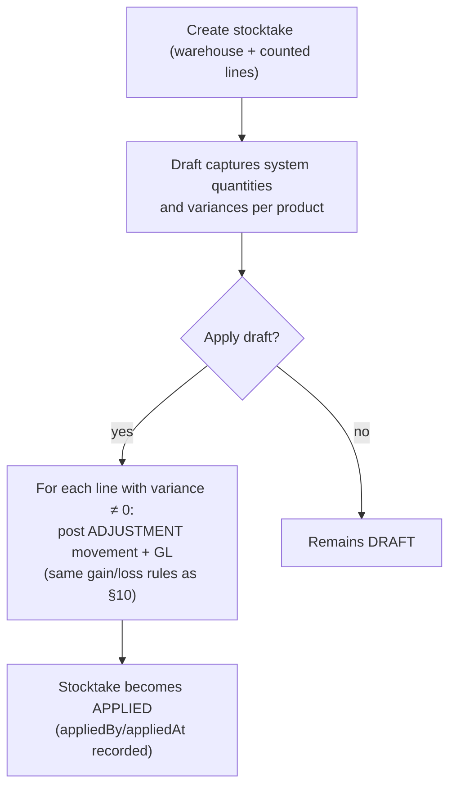

- Creating a count sheet records `systemQuantity` at capture time, the counted quantity, and the variance (`counted - system`) for each product in the selected warehouse.
- Only `DRAFT` stocktakes can be applied (`409 STOCKTAKE_NOT_DRAFT` otherwise). Applying posts variances as `ADJUSTMENT` movements and balanced GL entries (write-off: DR `5100` / CR `1200`; gain: DR `1200` / CR `5100`; zero-value variances post no journal), with the stocktake as the adjustment reference — no direct ledger or stock edits.
- Stocktakes are managed from Inventory → Stocktakes (`GET/POST /inventory/stocktakes`, `POST /inventory/stocktakes/:id/apply`).

## 11. Assigning a role (Settings)

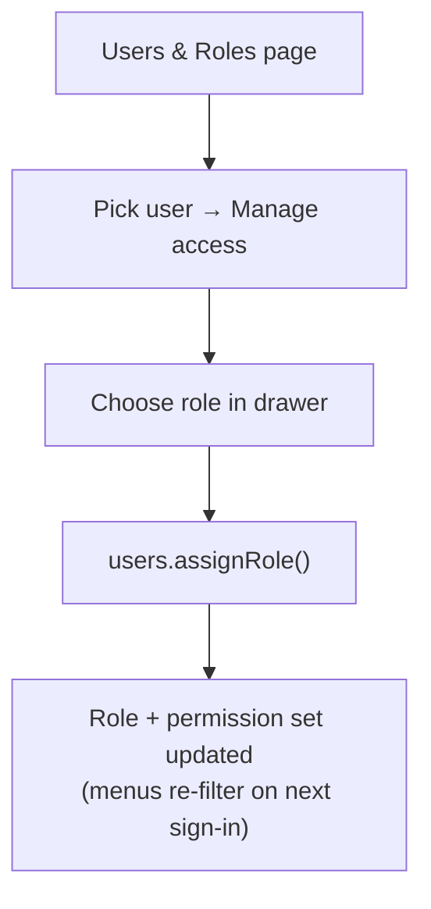

## 11a. Fiscal periods and year-end close

- **Fiscal calendar** — define fiscal years and periods with open/closed status (`/accounting/fiscal-periods`, `GET/POST /fiscal/years`, `POST /fiscal/years/:id/periods`).
- **Period lock** — journal create/edit/post/void and inventory operations that post value-dated effects are blocked when the relevant date falls in a closed period (`422 PERIOD_LOCKED`). Posting into a locked period is rejected; reports read posted data and remain consistent with period controls.
- **Reopen with audit** — closed periods can be reopened while the fiscal year is open (`POST /fiscal/periods/:id/reopen`), recording a reason in the fiscal audit trail (`GET /fiscal/events`).
- **Year-end close** — after all periods in a fiscal year are closed, year-end close (`POST /fiscal/years/:id/year-end-close`) posts a balanced closing entry (`referenceType YEAR_END_CLOSE`) that transfers revenue and expense balances to retained earnings (`3100`) and marks the year closed. The closing entry is a controlled final posting for that fiscal year.

## 12. Reports

- **Trial balance** — aggregates lines of `POSTED` entries in a date range, grouped by account; the net column sums to zero across all accounts; exportable as CSV. Each account drills into the account ledger.
- **Account ledger / general ledger detail** — per-account posted lines for a date range with opening balance, running balance, and closing balance (`GET /reports/account-ledger/:accountId`). From a ledger line you can open the journal and follow its source document reference (e.g. reversal, inventory movement, fiscal close) in ≤ 3 clicks from the trial balance.
- **Inventory valuation** — per-(product, warehouse) on-hand value at running `averageCost`, reconciled to the posted `1200` Inventory account balance (`difference`).
- **Inventory movement summary** — movement counts and in/out/value totals by month and movement type for a selected date range.
- **Inventory aging / slow-moving** — on-hand stock with last movement time and days since last movement as of a reference date.
- **Dashboard** — counts (accounts, products, journals, stock units), draft/posted split, low-stock items (`quantityOnHand ≤ reorderThreshold`) and the five most recent journals.

## Invariants enforced by the mock store (summary)

| # | Rule | Error surfaced |
| --- | --- | --- |
| 1 | Journal needs ≥ 2 lines with positive amounts | `INVALID_ENTRY` |
| 2 | Posting requires Σ debits = Σ credits | `UNBALANCED_ENTRY` |
| 3 | Posted entries are immutable; only drafts are editable/postable | `ENTRY_NOT_EDITABLE` / `ENTRY_NOT_POSTABLE` |
| 4 | Stock never goes negative (issue, transfer, adjustment) | `INSUFFICIENT_STOCK` |
| 5 | Movement ledger and posted entries are append-only | — (no edit/delete paths exist) |
| 6 | Account codes, SKUs and warehouse codes are unique | `DUPLICATE_CODE` / `DUPLICATE_SKU` |
| 7 | Referential guards: accounts with children/lines, products with stock/history, warehouses with stock/history cannot be deleted | `ACCOUNT_IN_USE` / `PRODUCT_IN_USE` / `WAREHOUSE_IN_USE` |
| 8 | Every mutation requires a signed-in user | `UNAUTHENTICATED` |
| 9 | Posting and value-dated inventory operations are blocked in closed fiscal periods | `PERIOD_LOCKED` |
