# Operations & Workflows (Stage A)

> Documents the workflows a user can actually drive in `apps/web` as built in
> Phase A (mock data source). Every rule shown here is enforced by the mock
> store, so it matches what Stage B's database will enforce.

## 1. Signing in and session handling

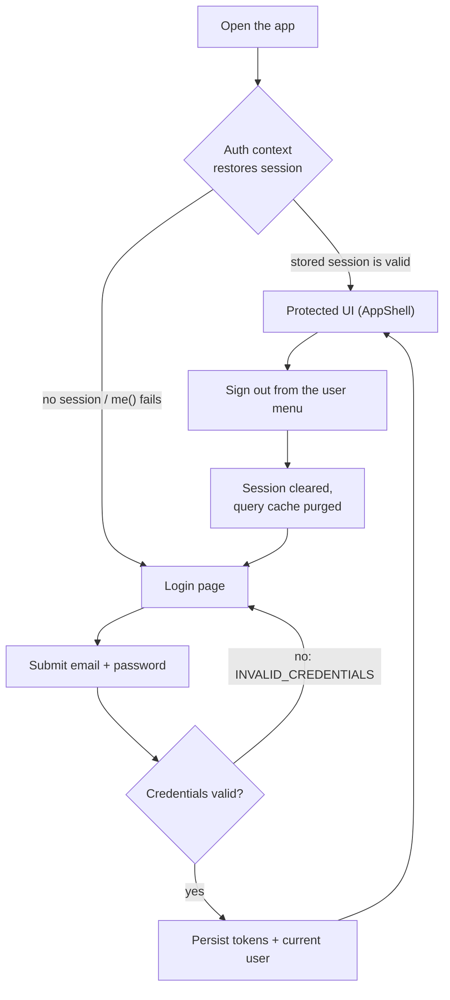

- Tokens (`mock-access.*`) are stored in `localStorage` (`src/auth/tokenStorage.ts`) — the same place the Stage C HTTP client will read them from.
- The mock store persists the current user id so a page reload keeps the session.

## 2. Route protection

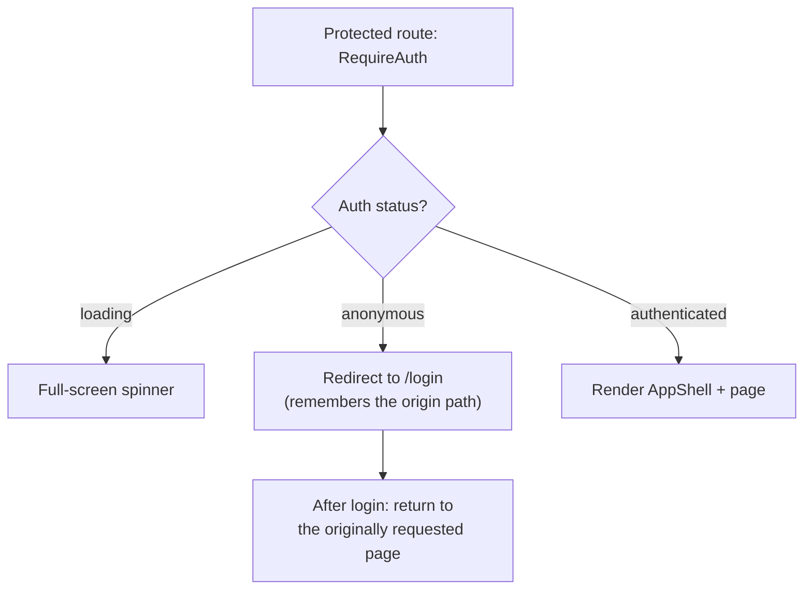

## 3. Role-based access control (RBAC)

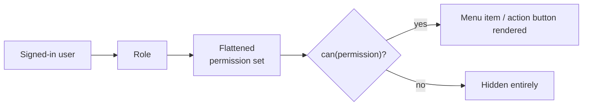

What each seeded role can see (permissions from `packages/shared`):

| Role | Dashboard | Accounting | Inventory | Operations (write) | Settings |
| --- | --- | --- | --- | --- | --- |
| `ADMIN` | ✔ | full + write | full + write | ✔ | users + role assignment |
| `ACCOUNTANT` | ✔ | full + write | read only | ✖ (read-only notice) | ✖ hidden |
| `STOREKEEPER` | ✔ | ✖ hidden | full + write | ✔ | ✖ hidden |
| `VIEWER` | ✔ | read only | read only | ✖ | ✖ hidden |

## 4. Journal entry lifecycle

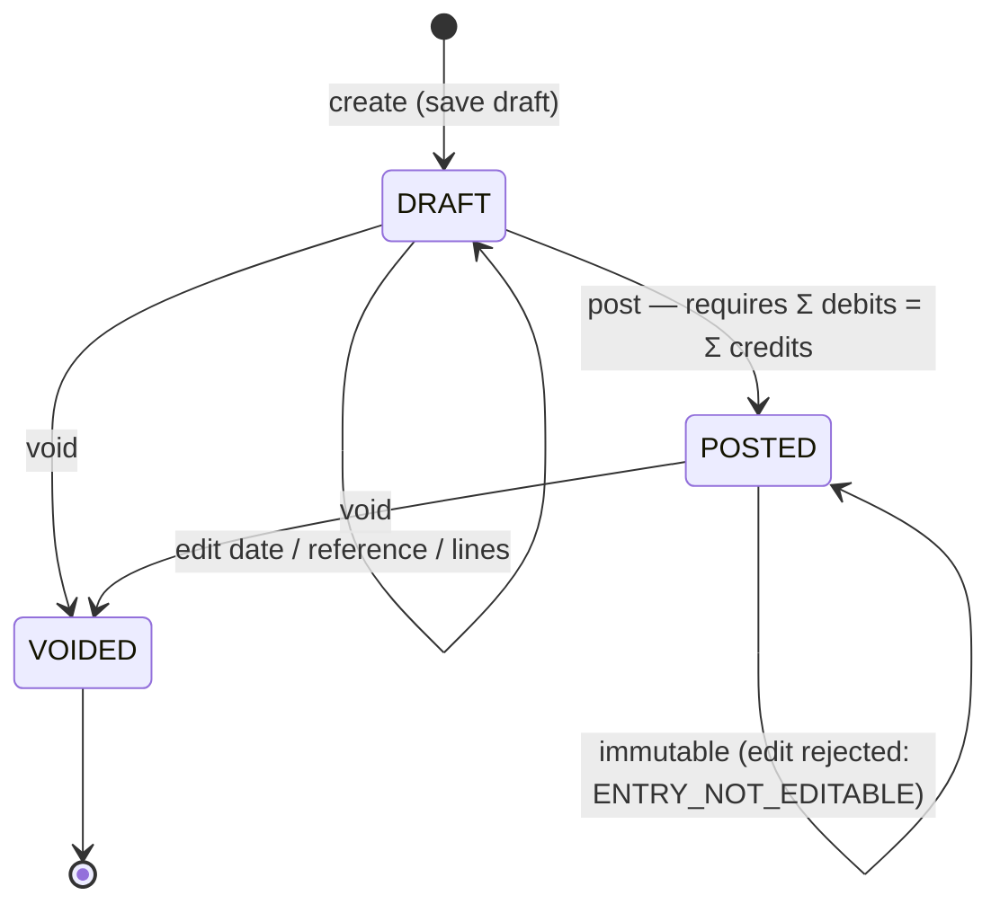

- Only drafts can be edited (`ENTRY_NOT_EDITABLE`) and only drafts can be posted (`ENTRY_NOT_POSTABLE`).
- `VOIDED` is terminal — voiding again is rejected (`ENTRY_ALREADY_VOID`).

## 5. Creating and posting a journal entry

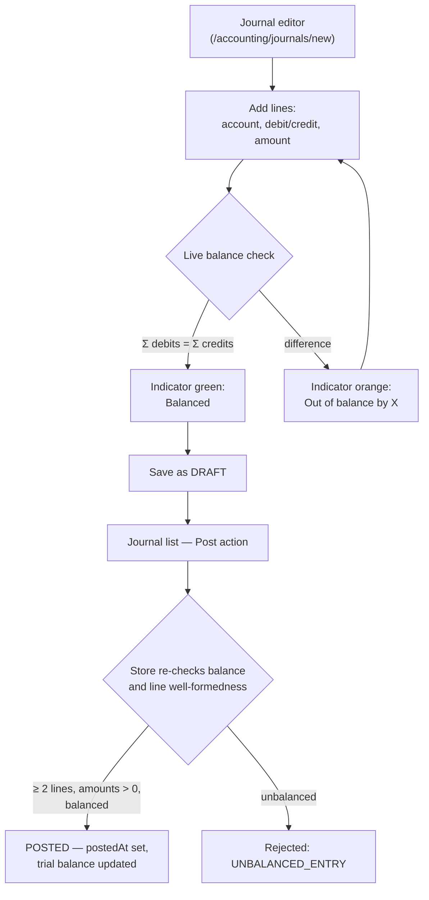

- Drafts are allowed to be unbalanced; the guard fires only at `post()`.
- The same editor page handles create (`new`) and edit (`:entryId/edit`, drafts only).

## 6. Chart of accounts maintenance

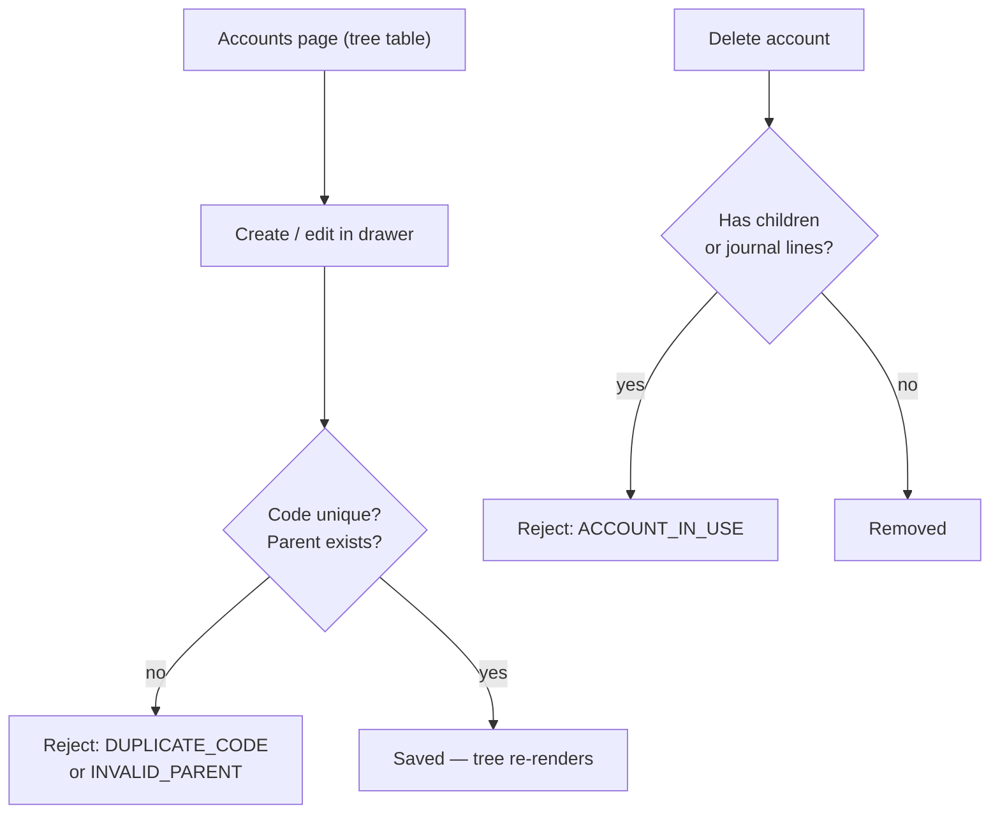

## 7. Goods receipt (Inventory → General Ledger integration)

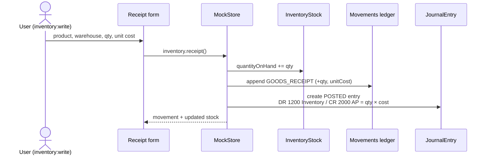

One operation produces **one stock increase, one append-only movement, and one balanced POSTED journal entry**.

## 8. Sales issue

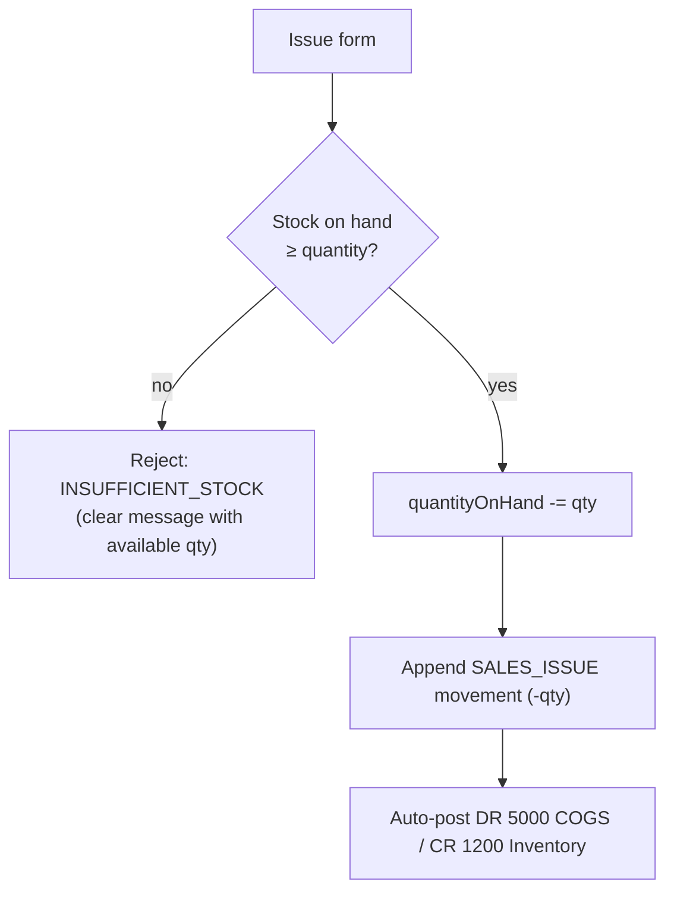

## 9. Warehouse transfer

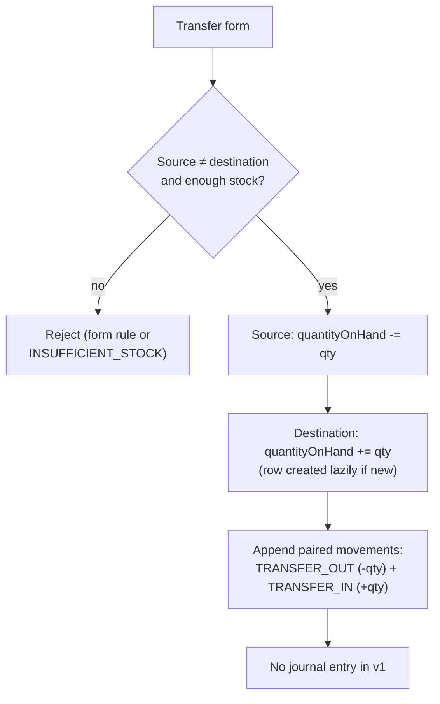

## 10. Stock adjustment

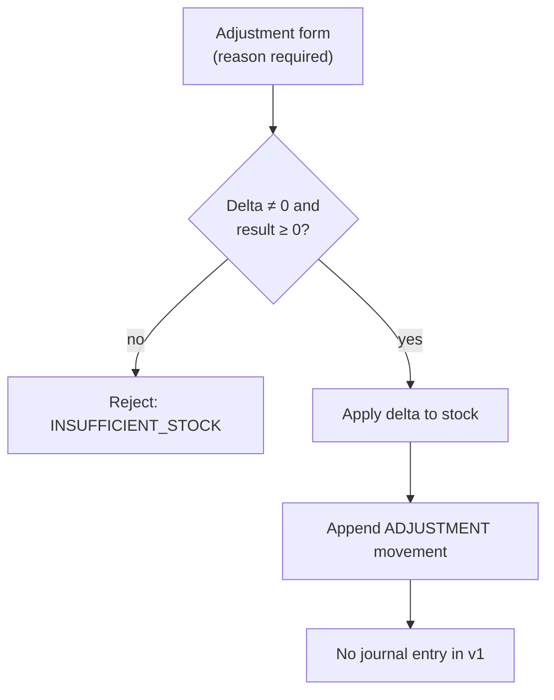

## 11. Assigning a role (Settings)

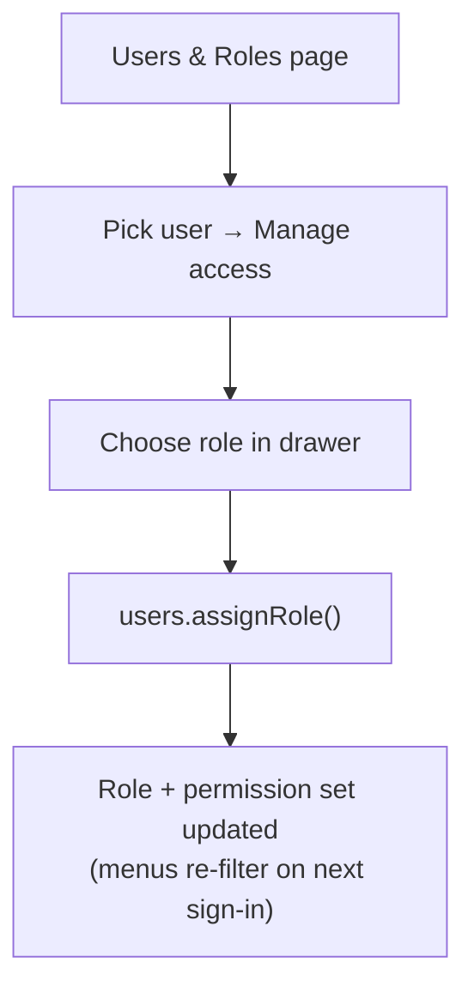

## 12. Reports

- **Trial balance** — aggregates lines of `POSTED` entries in a date range, grouped by account; the net column sums to zero across all accounts; exportable as CSV.
- **Dashboard** — counts (accounts, products, journals, stock units), draft/posted split, low-stock items (`quantityOnHand ≤ reorderThreshold`) and the five most recent journals.

## Invariants enforced by the mock store (summary)

| # | Rule | Error surfaced |
| --- | --- | --- |
| 1 | Journal needs ≥ 2 lines with positive amounts | `INVALID_ENTRY` |
| 2 | Posting requires Σ debits = Σ credits | `UNBALANCED_ENTRY` |
| 3 | Posted entries are immutable; only drafts are editable/postable | `ENTRY_NOT_EDITABLE` / `ENTRY_NOT_POSTABLE` |
| 4 | Stock never goes negative (issue, transfer, adjustment) | `INSUFFICIENT_STOCK` |
| 5 | Movement ledger and posted entries are append-only | — (no edit/delete paths exist) |
| 6 | Account codes, SKUs and warehouse codes are unique | `DUPLICATE_CODE` / `DUPLICATE_SKU` |
| 7 | Referential guards: accounts with children/lines, products with stock/history, warehouses with stock/history cannot be deleted | `ACCOUNT_IN_USE` / `PRODUCT_IN_USE` / `WAREHOUSE_IN_USE` |
| 8 | Every mutation requires a signed-in user | `UNAUTHENTICATED` |
